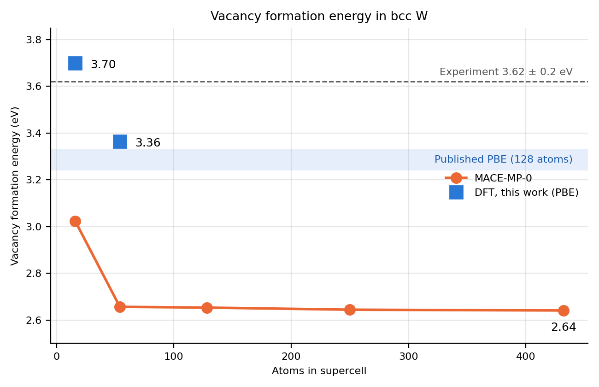

# Vacancy formation energy in bcc tungsten: DFT vs a universal ML potential

A short self-directed study by **Thomas Adesoye Adeoye** (University of Ibadan), October 2026.

## Motivation
Neutron irradiation in reactors knocks atoms off their lattice sites, leaving vacancies and interstitials whose accumulation causes swelling, hardening and embrittlement. The vacancy formation energy, E_vac, is the most basic input to models of this damage. Tungsten is a leading plasma-facing material for fusion reactors.

This study asks two questions:
1. What E_vac does DFT give for bcc W, and how strongly does it depend on supercell size?
2. Does an off-the-shelf universal machine-learning potential (MACE-MP-0) reproduce it?

## Methods
**DFT.** Quantum ESPRESSO 7.4.1, PBE functional, GBRV ultrasoft pseudopotential (14 valence electrons), 40/320 Ry cut-offs, Marzari-Vanderbilt smearing (0.02 Ry). Inputs were generated and analysed with Python/ASE.
- Lattice constant: seven-point energy scan (3.12 to 3.24 Å) on the 2-atom cubic cell, 12×12×12 k-points, parabolic fit.
- E_vac: perfect and vacancy supercells of 16 atoms (2×2×2, 6×6×6 k-points, laptop) and 54 atoms (3×3×3, 4×4×4 k-points, ICTP-EAIFR TWAS-1 cluster, 32 cores). Ionic positions relaxed with BFGS at fixed volume.

  E_vac = E(N−1) − [(N−1)/N] E(N)

**ML.** MACE-MP-0 (medium) through ASE on Google Colab; same procedure, supercells of 16 to 432 atoms, relaxation to forces below 0.01 eV/Å.

## Results

| | Lattice constant (Å) | E_vac 16 atoms (eV) | E_vac 54 atoms (eV) | E_vac 432 atoms (eV) |
|---|---|---|---|---|
| DFT, this work (PBE) | 3.186 | 3.70 | 3.36 | – |
| MACE-MP-0, this work | 3.190 | 3.02 | 2.66 | 2.64 |
| Published PBE, 128 atoms | – | – | – | 3.24 [1], 3.33 [2] |
| Experiment | 3.165 | – | – | 3.62 ± 0.2 [3] |

Relaxation energies (unrelaxed minus relaxed E_vac): DFT 0.05 eV (16 atoms) and 0.09 eV (54 atoms); MACE 0.16 eV and 0.37 eV.

## Findings
1. **Strong finite-size effect in DFT.** E_vac falls by 0.34 eV from 16 to 54 atoms. The 54-atom value (3.36 eV) lies just above published 128-atom PBE results (3.24 to 3.33 eV), consistent with a further small decrease in larger cells.
2. **MACE-MP-0 reproduces the bulk but not the defect.** Its lattice constant agrees with DFT to 0.1%, but it underestimates E_vac by about 0.7 eV and overestimates the ionic relaxation around the vacancy about fourfold.
3. **Likely cause: training data.** Both methods use PBE, so the gap is a model error. Universal potentials are trained mostly on near-equilibrium crystals, so defect environments are under-represented and the potential energy surface is too soft there.
4. **Implication.** Reliable radiation-damage simulations with ML potentials need training or fine-tuning on DFT defect configurations.

## Limitations
No k-point or cut-off convergence tests on the supercells; DFT limited to 54 atoms; only the monovacancy was studied (no interstitials or migration barriers).

## Possible next steps
DFT at 128 atoms; fine-tuning MACE on DFT defect data; vacancy migration barrier with the nudged elastic band method; self-interstitial configurations.

## Files
- `make_inputs.py`: writes the Quantum ESPRESSO inputs (lattice scan and supercells)
- `analyse.py`: extracts energies, fits the lattice constant, computes E_vac
- `job_W54.sh`: SGE job script for the 54-atom runs
- `mace_vacancy.py`: MACE-MP-0 calculations and the figure
- `outputs/`: Quantum ESPRESSO output files

## References
[1] D. Nguyen-Manh and S. L. Dudarev, "Trapping of He clusters by inert-gas impurities in tungsten: first-principles predictions and experimental validation", COSIRES 2014, arXiv:1408.0630.
[2] "On the stability and mobility of di-vacancies in tungsten", EUROfusion preprint WPPFC-PR(17)18984.
[3] Rasch, Siegel and Schultz (1980), as cited in [2]. Check the original before quoting.
